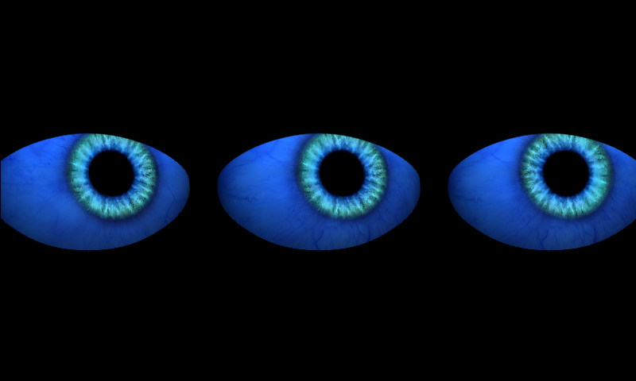

# house-eyes

The three-eyed house. A Raspberry Pi drives a projector that throws three
animated eyes onto a white sheet hung in front of the three second-floor
windows. The eyes look around and blink on their own.



*Screenshot from the emulator test run (see [docs/VM-TEST.md](docs/VM-TEST.md)),
not from the real projector.*

## How it works

| Piece | What it is |
|---|---|
| Computer | Raspberry Pi 4 Model B, hostname `eyes` (`eyes.local`), user `karlg` |
| OS | Raspberry Pi OS 11 "bullseye", 32-bit, Desktop image (2023-05-03), booted on the 32-bit kernel (`arm_64bit=0`) for the NCS2 |
| Output | HDMI0 to the projector. Boots at 640x480 @ 60 Hz; X then switches to the projector's preferred mode (1920x1080 on the current Hichip projector) |
| Eye software | [Adafruit Pi_Eyes](https://github.com/adafruit/Pi_Eyes) (MIT), rendered with [pi3d](https://pi3d.github.io/) |
| Our change | `eyes/tri-eyes.py`: Adafruit's two-eye `eyes.py` with a third, centre eye added, plus a UDP gaze input |
| People tracking | `tracker/`: a camera and an Intel Neural Compute Stick 2 find people on the sidewalk and steer the eyes to watch them. See [docs/TRACKING.md](docs/TRACKING.md) |
| Autostart | One line in `/etc/rc.local` |

Boot sequence:

1. The Pi boots to the text console (`multi-user.target`). The desktop is
   installed but never starts.
2. systemd runs `/etc/rc.local` as root, which ends with

   ```sh
   cd /boot/Pi_Eyes;xinit /usr/bin/python3 tri-eyes.py :0 &
   ```

3. `xinit` starts a bare X server on display `:0` with `tri-eyes.py` as its
   only client. pi3d opens a full-screen OpenGL ES window and draws the eyes.
4. `/etc/X11/xorg.conf` turns off screen blanking so the picture never sleeps.

There is no service, no login and no window manager. If `tri-eyes.py` exits,
X exits with it and the screen falls back to the console until the next reboot.

## What's in this repo

```
install.sh              Rebuilds the whole setup on a fresh Pi (see docs/INSTALL.md)
eyes/                   The code that runs. Copied to /boot/Pi_Eyes by install.sh
  tri-eyes.py           The three-eyed version (what boots)
  eyes.py, cyclops.py   Adafruit's originals: two eyes, one eye
  gfxutil.py, snake_eyes_bonnet.py   Helpers the eye scripts import
  graphics/             Eye shape SVGs and iris/sclera/lid textures
  variants/             Earlier experiments, kept for reference
  LICENSE               Adafruit's MIT licence for this code
tracker/                People tracking: tracker, installer, service, settings
config/as-found/        Verbatim copies of the config files on the live Pi
docs/INSTALL.md         Build a new one from a blank SD card
docs/OPERATIONS.md      Day-to-day: stop/start, tune, wifi, troubleshooting
docs/TRACKING.md        People tracking: install, calibrate, test, troubleshoot
docs/AS-FOUND.md        What was actually on the Pi when it was surveyed
docs/VM-TEST.md         How the install was verified in an emulator
```

## Quick reference

```sh
ssh karlg@eyes.local

# Stop the eyes
sudo killall xinit

# Start them again by hand (same command rc.local uses)
cd /boot/Pi_Eyes && sudo xinit /usr/bin/python3 tri-eyes.py :0 &

# Why didn't they start?
journalctl -b -u rc-local --no-pager | tail -40

# Make the eyes look screen-right for 2 seconds (gaze input)
echo "1 0" | nc -u -w0 eyes.local 5005

# People tracker
journalctl -u house-eyes-tracker -f       # live log
# calibration view: http://eyes.local:8080/

# Projector output off / on without stopping anything
vcgencmd display_power 0
vcgencmd display_power 1
```

More in [docs/OPERATIONS.md](docs/OPERATIONS.md).

## Where the code came from

- Upstream: <https://github.com/adafruit/Pi_Eyes>, installed by Adafruit's
  `pi-eyes.sh` from <https://github.com/adafruit/Raspberry-Pi-Installer-Scripts>.
- Fork with the three-eye commit: <https://github.com/karlg100/Pi_Eyes>
  (commit `956c7f1`, "added triple eyed version", 2023-10-29).
- `eyes/` here is a copy of what was running in `/boot/Pi_Eyes` on the Pi on
  2026-10-03. `tri-eyes.py` is byte-identical to the one in the fork.
