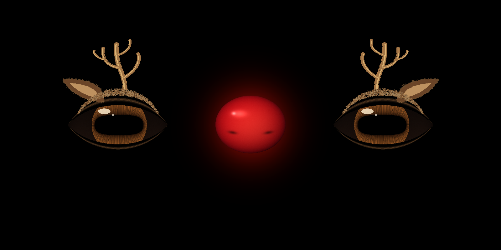
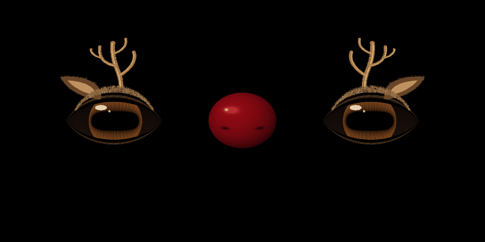

# Christmas: the three-window reindeer

The outer windows become warm brown reindeer eyes; the centre window is
only Rudolph's red nose. The eyes keep the existing gaze tracking, pupil
motion and blinks. Horizontal pupils, dark chocolate sclera, small corneal
reflections, furry brows, ears and antlers make the face read as a reindeer.
The background stays black for projection onto the window sheet.



This is an **offline preview of the actual SVG meshes and textures**, with
approximate lighting, at 1600×800, radius 160, spacing 0.265. It is not a
photo of the house or a Pi GPU screenshot. The default radius remains 128.
The antlers can be hidden if they don't fit inside your window openings.



The GIF demonstrates the actual nose brightness envelope with a static eye
pose. On the Pi the eyes also move, dilate and blink normally.

## Run on the Pi

Copy the updated **entire `eyes/` directory**, including `seasonal.py` and
`graphics/christmas/`, into `/boot/Pi_Eyes`. From a checkout on the Pi:

```sh
sudo cp -r eyes/. /boot/Pi_Eyes/
sudo killall xinit
cd /boot/Pi_Eyes
sudo xinit /usr/bin/python3 christmas-eyes.py :0
```

`christmas-eyes.py` is a thin launcher for `tri-eyes.py --theme christmas
--no-rogue`. It keeps the pair coordinated while idle. The normal Halloween
entry point and its default assets remain unchanged. To return to Halloween,
stop X and launch `tri-eyes.py` instead.

To keep Christmas after reboot, change the script name in the existing
`/etc/rc.local` startup line from `tri-eyes.py` to `christmas-eyes.py`.
For a fresh install, the existing installer also accepts:

```sh
sudo EYES=christmas-eyes.py ./install.sh
```

## Nose controls

By default, the red nose is visible but unlit. After a random quiet interval
of 12–35 seconds, it smoothly brightens for 2.5–5 seconds, then fades back.
There is no strobe. A new quiet interval begins after each glow ends.

Send these ASCII messages to the existing **UDP port 5005**:

| Message | Result |
|---|---|
| `nose pulse` | Four-second glow, then return to the previous mode |
| `nose pulse 6` | Six-second glow (allowed duration: 0.5–30 seconds) |
| `nose on` | Hold the nose fully illuminated |
| `nose off` | Disable illumination and random glows; keep the dark red nose visible |
| `nose auto` | Resume random glows after a fresh quiet interval |

Example from any computer with Python 3 on the same LAN:

```sh
python3 -c 'import socket; socket.socket(socket.AF_INET, socket.SOCK_DGRAM).sendto(b"nose pulse 4", ("eyes.local", 5005))'
```

Press **N** on the Pi keyboard for a four-second pulse. This also works
when `--gaze-port 0` disables the UDP listener. Escape exits as before.

The show controller can send the same UDP payloads. There is no new MQTT
subscription: the existing MQTT tracking switch continues to work as before.
Nose commands do not refresh the gaze timeout. Existing `x y` and
`xl yl xc yc xr yr p=...` datagrams still steer the two outer eyes; the
middle target is not drawn. The nose stays stationary and never blinks.
Malformed nose commands are ignored without changing the current mode.

## Fit the three windows

The existing `--radius` and `--spacing` options retain their meanings.
New options are:

| Option | Default | Meaning |
|---|---|---|
| `--theme christmas` | `halloween` in tri-eyes.py | Reindeer assets and centre nose |
| `--nose-mode auto\|on\|off` | `auto` | Initial illumination mode |
| `--nose-every MIN MAX` | `12 35` | Quiet interval range, in seconds |
| `--nose-scale FACTOR` | `0.78` | Nose sprite radius relative to eye radius |
| `--nose-y PIXELS` | `0` | Vertical nose offset; positive is up on the projector |
| `--no-antlers` | off | Hide ears, antlers and furry brow accents |

For example, lower the nose slightly and make the random glow less frequent:

```sh
sudo xinit /usr/bin/python3 christmas-eyes.py --radius 160 --spacing 0.265 --nose-y -25 --nose-every 20 50 :0
```

The outer accents extend about 1.4 eye radii sideways and 1.8 radii upward
from each eye's centre. Check this against the real window apertures. Begin
with the current house radius and spacing; the preview dimensions are only
for reviewing the design. Check the lit and unlit nose from the street.

## Artwork and validation

`graphics/christmas/reindeer-eye.svg` supplies the same named geometry paths
as Adafruit's eye SVG. The iris PNG is an **unwrapped annulus**: horizontal
coordinates run around the pupil; vertical coordinates run from pupil to
outer iris. A flat photograph of an eye will not work as this texture.
The eyelid map retains the black mask row required by `gfxutil.py`.
The nose uses three inexpensive unlit sprites: halo, dark red surface and
bright red surface. Its brightness is independent of the eyeball light.

Artwork is generated deterministically by `tools/build_christmas_assets.py`.
All generated runtime assets are included; nothing needs generating on the Pi
and no new runtime packages are required.

For development, install `tools/requirements-preview.txt` in a virtualenv:

```sh
python3 tools/build_christmas_assets.py
python3 tools/preview_christmas.py --animate
python3 -m unittest discover -s tests -v
python3 -m pytest tracker/
```

Tests cover random scheduling, all command modes, malformed packets, pulse
duration limits, nose/gaze independence, outer-eye tracking, hidden centre
geometry, full blink closure, finite meshes and the original Halloween assets.
The offline renderer executes the real initialization and `frame()` code
with a recording pi3d substitute. It cannot validate the Pi's GPU driver,
frame rate, projector colour, sheet alignment or street visibility; those
still require a hardware check. This feature has not been deployed to the Pi.
