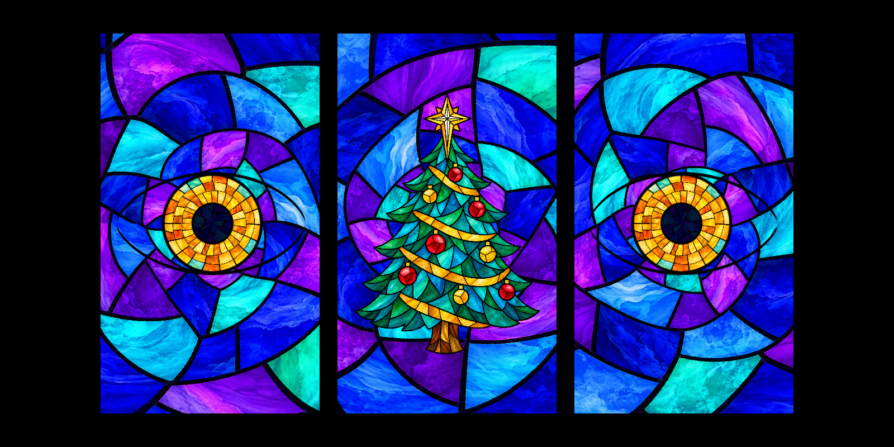
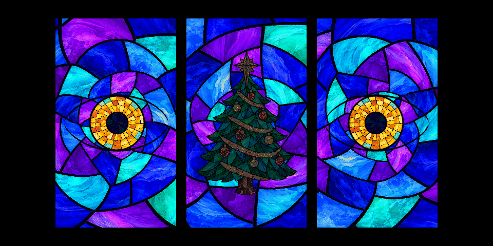

# Stained-glass Christmas eyes

Three complete rectangular stained-glass windows: animated eyes formed within
the outer panels and an emerald Christmas tree within the centre panel,
topped by a long-pointed golden Bethlehem star. The artwork
follows the supplied Nativity video's cobalt-violet palette, turquoise accents,
black leading and cloudy marbled glass. See [artwork and prompts](ARTWORK.md).





These are offline renders using CPU equivalents of the window and tree
shaders with the actual artwork. The GIF includes eye motion, a blink and a
six-second tree lighting cue. The still uses radius 170 at 1600×800 for review;
the GIF scales that layout to 960×480. The Pi default radius stays 128.
Filtering and projected colours can differ from this preview.

## Launch

Copy the whole updated `eyes/` directory to `/boot/Pi_Eyes`, including the
new `shaders/` directory and all artwork. From a checkout on the Pi:

```sh
sudo cp -r eyes/. /boot/Pi_Eyes/
sudo killall xinit
cd /boot/Pi_Eyes
sudo xinit /usr/bin/python3 stained-glass-eyes.py :0
```

The launcher runs `tri-eyes.py --theme stained-glass --no-rogue`. Existing
gaze tracking, dilation and blinks continue to work. Six-coordinate gaze
messages use the first and last pairs for the outer eyes; the centre target
does not move the tree. The centre eye and lids are not drawn.
Glass fills every panel right to its edges. When an eye closes, its surrounding
glass remains lit and the black lead contour closes into a line. The pupils
are dark blue glass, and the tree has a complete glass background.
The blue panes radiate around each iris. One continuous deformation carries
the glass texture, leading, eye contour and iris together as the gaze changes.
Blinks pull the surrounding panes toward the closing lid, and pupil dilation
gently stretches adjacent panes. The window perimeter stays fixed so the
projection remains aligned. The middle glass field follows half the pair's
average gaze flow while the tree keeps its independent light sequence.

For startup on an existing Pi, change the script name in the `/etc/rc.local`
startup line to `stained-glass-eyes.py`. The existing installer supports
`sudo EYES=stained-glass-eyes.py ./install.sh` for a fresh setup.

## Tree animation and controls

In `auto` mode, each glass pane slowly varies in brightness. Every 8–18 seconds
after the previous cue finishes, a 2.5–5 second sweep rises from the bottom
of the tree and ends in the star. The outlines and artwork stay fixed; the
light changes inside the panes. There is no additive white wash or strobe.

Send ASCII commands to the existing UDP port 5005:

| Message | Effect |
|---|---|
| `tree auto` | Gentle shimmer and occasional upward lighting sweeps |
| `tree on` | Steady full illumination, no animation |
| `tree off` | Stop animation and dim the tree; it remains visible |
| `tree pulse` | Four-second lighting cue, then resume the prior mode |
| `tree pulse 6` | Six-second cue; duration can be 0.5–30 seconds |

Press **T** on the Pi keyboard for a six-second cue. Nose commands affect
only the reindeer theme; tree commands affect only stained glass. Neither
kind of cue refreshes or changes the eye-tracking target.

```sh
python3 -c 'import socket; socket.socket(socket.AF_INET, socket.SOCK_DGRAM).sendto(b"tree pulse 6", ("eyes.local", 5005))'
```

The controls are UDP and keyboard controls. No new MQTT subscriptions are added.

## Window fit

Use the existing `--radius` and `--spacing` settings for the eyes. The new
`--tree-scale` option multiplies a tree width of twice the eye radius, keeping
the artwork's aspect ratio. `--tree-y` moves it vertically in projector pixels,
positive upward. At radius 128, the default tree is about 256×355 pixels.
`--window-width` and `--window-height` set the full panel dimensions in eye
radii; defaults are 2.3 and 4.0. At radius 128 each glass rectangle is
294×512 pixels. Set these to cover the actual window openings while using
`--spacing` to align their centres. The black gaps in the preview represent
the wall between the windows.

```sh
sudo xinit /usr/bin/python3 stained-glass-eyes.py --radius 128 --spacing 0.265 --tree-scale 0.9 --tree-y -20 --tree-every 12 25 :0
```

Other options: `--tree-mode auto|on|off`, `--tree-every MIN MAX` in seconds.
All tree options are optional. Start with the current house alignment and
check both the star and the bottom of the tree within the middle window.

## Implementation and validation

The full-window shader draws an opaque blue-violet glass field and forms the
eye from a lead outline, glass sclera, unwrapped gold iris and dark glass pupil.
It receives gaze, pupil and blink values from the existing animation/tracking
pipeline. A shared coordinate deformation flows the complete window, using
radial glass courses and a fixed perimeter. The old eye-shaped meshes and black eyelid masks are not drawn in
this mode, so the complete window remains glass throughout each blink.

The tree uses one textured quad and two texture samples per pixel: artwork
and a precomputed pane data map. Its shader preserves the glass colours and
changes each pane's illumination together. No per-frame CPU image processing
or new runtime packages are needed.

Developer checks (install `tools/requirements-preview.txt` in a virtualenv):

```sh
python3 tools/build_glass_panes.py
python3 tools/preview_stained_glass.py --animate
python3 -m pytest tests tracker -q
```

Validation on the development Mac: 29 tests passed, including the existing
Halloween/reindeer and tracker tests. The actual new GLSL shaders also compiled,
linked and rendered in a WebGL 1 test using the pi3d 2.49 GLES2 include expansion;
on/off/pulse pixel values were checked with no GL errors.

The Raspberry Pi GPU, frame rate and projector alignment/brightness have not
been tested for this motif. Nothing has been installed or switched on the house.
