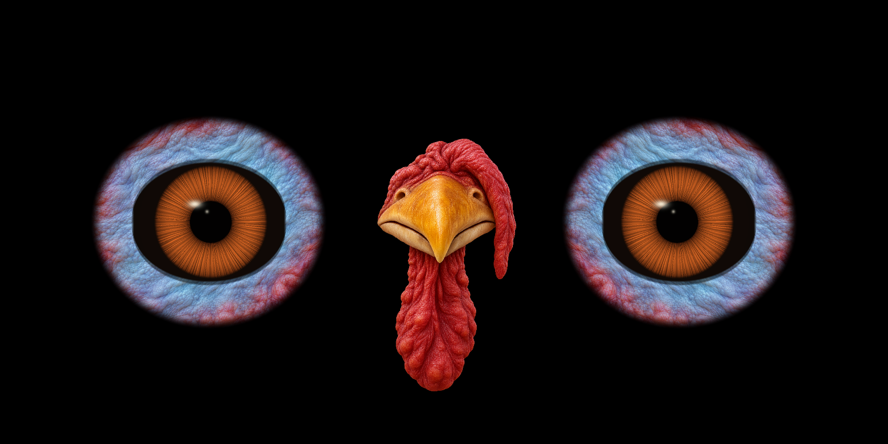

# Thanksgiving turkey eyes

Two amber turkey eyes with blue-and-red bare facial skin in the outer windows.
A golden beak, red snood and wattle fill the centre window. The eyes retain
gaze tracking, pupil motion and blinks. The skin moves slightly with gaze and
folds into the eyelid during a blink.




These previews use the actual scene setup and a CPU equivalent of the turkey
shader. The still is 1600×800 with radius 170; the six-second animation is
800×400 with radius 85. Lighting, GPU filtering and street visibility still
need checking on the projector. The runtime default radius remains 128.

## Run on the Pi

From a checkout on the Pi, copy the complete updated `eyes/` folder,
including shaders, artwork and helper modules:

```sh
sudo cp -r eyes/. /boot/Pi_Eyes/
sudo killall xinit
cd /boot/Pi_Eyes
sudo xinit /usr/bin/python3 thanksgiving-eyes.py :0
```

The launcher selects `tri-eyes.py --theme thanksgiving --no-rogue`, keeping the
two eyes coordinated while idle. You can also launch `tri-eyes.py --theme
thanksgiving` directly. Existing UDP gaze messages on port 5005 work normally:
`x y`, or `xl yl xc yc xr yr p=...`. The outer pairs control the two eyes;
the centre gaze pair is unused. The beak remains stationary.

To make this the startup mode, change the script name in the existing
`/etc/rc.local` line to `thanksgiving-eyes.py`. For a fresh install, the
existing installer accepts `sudo EYES=thanksgiving-eyes.py ./install.sh`.

## Fit the windows

The existing `--radius` and `--spacing` control overall scale and the distance
to the outer eye centres. Each coloured eye patch is 2.6 radii wide and
2.4 radii tall, with an oval silhouette fading into the black background.

| Option | Default | Meaning |
|---|---|---|
| `--beak-scale` | `1.0` | Scale the centre beak and wattle together |
| `--beak-y` | `0` | Adjust the beak vertically in projector pixels; positive is up |

The beak sprite is 2.05 eye radii wide at scale 1.0, keeping the artwork's
aspect ratio. Its centre starts 0.45 radii below the eyes, aligning the
beak above the hanging wattle. `--beak-y` adjusts that baseline.

```sh
sudo xinit /usr/bin/python3 thanksgiving-eyes.py --radius 128 --spacing 0.265 --beak-scale 0.9 --beak-y 15 :0
```

There are no new MQTT subscriptions or UDP cue commands for this mode.
The existing people-tracker switch continues to control tracking.

## Artwork and rendering

The built-in image-generation tool created these project assets:

- `eyes/graphics/thanksgiving/skin.png`: blue skin and coral/cranberry caruncles,
  sampled by the animated eye shader.
- `eyes/graphics/thanksgiving/beak.png`: transparent beak, snood and wattle.

The unwrapped brown iris material is shared with
`eyes/graphics/christmas/iris.png` and given a copper/amber tint by the shader.
Round pupils, soft corneal reflections and the eyelid are rendered dynamically;
no eye or pupil is baked into the skin artwork. The original eye-shaped meshes
are skipped in this mode. Runtime rendering needs no new packages and does
no image generation or CPU texture processing.

### Skin prompt

Opaque output, no reference image:

Use case: photorealistic-natural. Asset type: production albedo texture for the bare skin around an animated male turkey's eye, mapped onto a softly oval face patch in a Thanksgiving house projection. Make a SQUARE flat texture entirely filled edge to edge with turkey facial skin, no visible eye, NO eye opening, no black hole, no beak, no feathers, no anatomy except skin. The CENTRAL 60% area should be pale powder blue and icy cyan turkey skin with many delicate folds and fine irregular pebbling; the OUTER 20% perimeter transitions to warm coral red, cranberry red, and burgundy fleshy round caruncles and soft wrinkles. The transition is organic and asymmetrical but roughly centred. The skin is softly rounded and naturally translucent, detailed enough for a realistic turkey, attractive for a family holiday display rather than grotesque. Broad soft lighting from upper left, no strong shadow, gentle occlusion in folds. Skin grain is real rounded wrinkles and pebbles, no repeated grid, no scales, no reptile plates, no veins, no wounds, no teeth, no text. Straight-on surface map with no perspective, seamless darkening near the outer boundary is not needed because the renderer supplies its own shape and alpha falloff. Fully opaque, full bleed skin material only.

### Beak prompt

Transparent output, no reference image:

Use case: stylized-concept. Asset type: transparent production sprite, the centre window of a house-projected Thanksgiving turkey face. Create ONE isolated front-facing TURKEY BEAK with its RED SNOOD and WATTLE, no eyes and no whole head. Golden ochre upper beak, broad near the top, triangular with gently hooked tip, small realistic nostrils near the sides, warm ivory lower rim and a natural thin dark mouth seam. Above the beak, a short gathered cranberry-red wrinkled fleshy base; a long curved soft red snood droops down one side of the beak. Beneath it, an elegant long crimson wattle with naturally rounded caruncles and folds. The upper beak is wide enough to read from a street, and the wattle extends about 1.2 beak heights below it. Friendly majestic live turkey, softly realistic, high-quality warm 3D character rendering with real feather-free turkey skin wrinkles and golden horn beak texture, matching natural bare turkey facial skin. No exaggerated toy-plastic shine. Soft upper-left light with gentle dimensional shading. Composition: straight-on symmetrical beak silhouette, centred portrait canvas, complete snood and wattle visible with generous margin, no eyes, NO head, no neck cylinder, no body, no feathers, no tail, no accessories, no hat, no lettering. Genuinely transparent background, no floor, no backdrop, no cast shadow outside the subject. This sprite sits between two separately animated turkey eyes; it must clearly read as the central beak and red wattle of a turkey.

## Validation

```sh
python3 -m pytest tests tracker -q
python3 tools/preview_thanksgiving.py --animate
```

The development Mac passed 35 tests, covering all earlier themes and the tracker
plus the turkey's tracking direction, pupil response, skin-coloured blink
closure, centre replacement, beak sizing/alignment, finite shader output and
transparent artwork. The turkey vertex and fragment shaders are also checked
by compiling, linking and drawing them in a local WebGL 1 test with pi3d 2.49's
GLES2 include expansion. This is not a Raspberry Pi performance or projection
test. Nothing has been deployed to the house.

